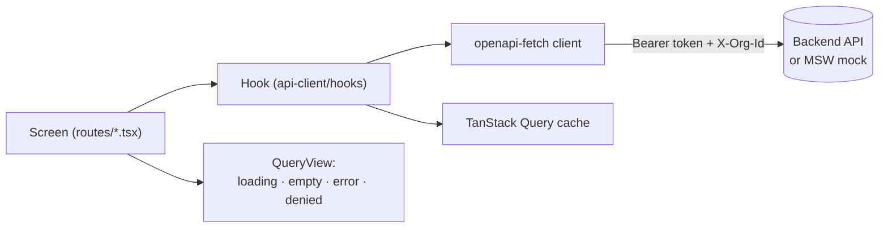

# Stellar Finance OS — Web

> Repo 3 of 3 · `finance-os-web` · React + Tailwind monorepo
> Sibling repos: [`finance-os-backend`](../finance-os-backend) (API, indexer) · [`finance-os-contracts`](../finance-os-contracts) (Soroban)

The frontend for Stellar Business Treasury & Finance OS. Two apps share four packages:

- **Dashboard** (`apps/dashboard`) — where a business's team manages invoices, clients, vendors, approvals, treasury,
  reconciliation and settings.
- **Pay** (`apps/pay`) — a small public page a business's client opens to pay an invoice in USDC on Stellar.

The web app holds **no business logic** beyond display and form validation. All data comes from the backend API. The only
Stellar action that happens here is **signing**: the user's wallet signs transactions — built by the backend for outgoing
payments, or built in the browser when a client pays an invoice.

## Contents

1. [Status](#status)
2. [Quick start](#quick-start)
3. [Configuration](#configuration)
4. [Repository layout](#repository-layout)
5. [Architecture](#architecture)
6. [Dashboard app](#dashboard-app)
7. [Pay app](#pay-app)
8. [Packages](#packages)
9. [Mock API](#mock-api)
10. [Testing & CI](#testing--ci)
11. [Conventions](#conventions)
12. [Build order](#build-order)
13. [Tech stack](#tech-stack)

## Status

Build-order tasks 1–12 are implemented and run end to end against an **in-memory mock API** (MSW). The real backend is not
wired up yet — `packages/api-client/openapi.seed.json` is the API contract the frontend expects the backend to serve.

| Works today (against the mock API)                                    | Still to do                                             |
| --------------------------------------------------------------------- | ------------------------------------------------------- |
| Login / register, org switcher, role-based UI                         | Point at the real `finance-os-backend`                  |
| Clients and invoices: create, send, void, pay link                    | Verify real Freighter signing on testnet                |
| Pay page: wallet pay, SEP-7 QR, live "Paid ✓" status                  | "Paid" after a _real_ payment needs the backend indexer |
| Vendors, payment requests, multi-approver approvals                   | Playwright end-to-end tests (task 13)                   |
| Sign & send outgoing payments                                         | Route-level code splitting for the dashboard bundle     |
| Transactions + manual match, dashboard, reports, CSV export, settings |                                                         |

## Quick start

Requires Node 22+ (`.nvmrc` pins 24) and pnpm 12.

```bash
pnpm install
cp .env.example .env     # mocks are on by default
pnpm dev                 # dashboard → http://localhost:5173 · pay → http://localhost:5174
```

With `VITE_ENABLE_MOCKS=true` the whole API is served in the browser by MSW — no backend needed. Log in with any of these
(password `password`):

| Email                            | Role                                                        |
| -------------------------------- | ----------------------------------------------------------- |
| `ada@acme.test`                  | Owner (also Admin of a second org, to try the org switcher) |
| `ben@acme.test`, `eze@acme.test` | Approver                                                    |
| `chi@acme.test`                  | Accountant                                                  |
| `dee@acme.test`                  | Viewer                                                      |

Public pay pages: `http://localhost:5174/i/pub_1001` (unpaid), `/i/pub_1006` (partially paid), `/i/pub_1003` (paid).

### Scripts

| Command             | What it does                                                                                     |
| ------------------- | ------------------------------------------------------------------------------------------------ |
| `pnpm dev`          | Run both apps (Turborepo)                                                                        |
| `pnpm build`        | Typecheck and build both apps to `apps/*/dist`                                                   |
| `pnpm lint`         | ESLint across the workspace                                                                      |
| `pnpm typecheck`    | `tsc --noEmit` in every package                                                                  |
| `pnpm test`         | Vitest in every package                                                                          |
| `pnpm format`       | Prettier                                                                                         |
| `pnpm api:generate` | Regenerate `packages/api-client/src/schema.ts` from the backend (`--seed` to use the local spec) |

## Configuration

Both apps read one `.env` at the **repo root** (`envDir: '../..'` in each `vite.config.ts`). Copy `.env.example`.

| Variable               | Default                    | Used by   | Purpose                                                                      |
| ---------------------- | -------------------------- | --------- | ---------------------------------------------------------------------------- |
| `VITE_API_URL`         | `http://localhost:3000/v1` | both      | Backend base URL (also the base the mocks answer on)                         |
| `VITE_STELLAR_NETWORK` | `testnet`                  | both      | `testnet` or `mainnet`; must match the backend. Drives wallet network checks |
| `VITE_EXPLORER_URL`    | stellar.expert testnet     | both      | "View on explorer" links                                                     |
| `VITE_PAY_APP_URL`     | `http://localhost:5174`    | dashboard | Base of invoice pay links (`/i/:publicToken`)                                |
| `VITE_HORIZON_URL`     | Horizon testnet            | pay       | Where the pay page loads the payer's account and submits their payment       |
| `VITE_ENABLE_MOCKS`    | `true`                     | both      | Dev only: serve the API from MSW. Ignored in production builds               |

## Repository layout

```
finance-os-web/
├── apps/
│   ├── dashboard/src/
│   │   ├── auth/          # session store, AuthProvider, route guards, role → permission matrix
│   │   ├── components/    # app-level pieces: QueryView, Can, OrgSwitcher, UserMenu, NetworkBadge
│   │   ├── features/      # per-domain building blocks (invoices, payments, approvals, transactions, …)
│   │   ├── layouts/       # sidebar app shell, auth layout, nav items
│   │   ├── routes/        # one file per screen (+ settings/ sub-pages), each with a *.test.tsx
│   │   ├── test/          # renderApp() + MSW node server for tests
│   │   ├── router.tsx     # route table and guards
│   │   ├── providers.tsx  # API client, TanStack Query, auth, wallet
│   │   └── mocks.ts       # starts MSW in dev when VITE_ENABLE_MOCKS=true
│   └── pay/src/
│       ├── components/    # invoice summary, connect-wallet pay, pay-from-any-wallet (QR), paid banner
│       ├── lib/           # SEP-7 URI builder, lazy Horizon client
│       ├── routes/        # /i/:publicToken and the missing-link fallback
│       └── test/          # renderPay() + MSW node server
├── packages/
│   ├── api-client/        # generated schema, typed client, TanStack Query hooks, MSW mocks
│   ├── ui/                # shadcn-style components, charts, DataTable, Tailwind v4 tokens
│   ├── wallet/            # Stellar Wallets Kit wrapper, network/signer checks, client-side payment builder
│   └── utils/             # money (big.js), dates, address display, Stellar format checks
├── .github/workflows/ci.yml
├── turbo.json · pnpm-workspace.yaml · tsconfig.base.json · eslint.config.js
├── .env.example
└── AGENTS.md              # rules for AI assistants working in this repo
```

Internal packages are consumed as TypeScript source (their `exports` point at `src/`), so there is no package build step.

## Architecture

### Data flow



- Screens never call `fetch`. They use hooks from `@finance-os/api-client` (`useInvoices`, `useApprovePaymentRequest`, …),
  which call the typed `openapi-fetch` client and throw `ApiError` (with `status`) on failure.
- Mutations invalidate the right queries through the shared `keys` object, so lists and details stay in sync.
- `QueryView` (`apps/dashboard/src/components/query-view.tsx`) renders the four required states: loading, empty, error
  (with retry), permission denied (403), plus not found (404).

### Auth and organizations

- `auth/session-store.ts` keeps `{ token, orgId }` in `localStorage` (only the API token — never a Stellar key).
- The API client sends `Authorization: Bearer <token>` and `X-Org-Id: <orgId>`; a 401 clears the session.
- `AuthProvider` loads `/me` (user + memberships). The active membership's role drives the UI.
- `RequireAuth` / `RedirectIfAuthenticated` guard routes and return users to the page they were heading to after login.
- Switching org resets cached queries so data from the previous org never flashes on screen.

### Role-based UI

`auth/permissions.ts` maps `owner | admin | approver | accountant | viewer` to permissions such as `invoices:write`,
`payments:submit` or `settings:manage`. Use `<Can permission="…">` or `usePermission()` to hide or disable controls.
**This is UX only — the backend enforces permissions.** Per-record rights the server decides (e.g. whether _you_ may approve
a request) come from the API as `canApprove` / `canSubmit`.

### Outgoing payments (dashboard)

```
approved PaymentRequest → "Sign & send"
  → POST /payment-requests/:id/build-tx      backend returns unsigned XDR + readable summary
  → show summary (to, amount, memo, from, fee) — the user reads it before the wallet opens
  → wallet.signTransaction(xdr, { expectedSigner: treasuryAddress })
       blocks on network mismatch, or if the connected wallet isn't the paying treasury account
  → POST /payment-requests/:id/submit { signedXdr }
  → poll the request until settled | failed
```

Code: `features/payments/use-sign-and-send.ts`, `sign-and-send-panel.tsx`.

### Paying an invoice (pay app)

```
"Connect wallet & pay"
  → wallet connect → load payer account from Horizon → build payment to the invoice's muxed (M-) address
  → show summary → payer signs → submit to Horizon
  → page keeps polling GET /public/invoices/:token and flips to "Paid ✓" when the backend matches the payment
```

Or **pay from any wallet**: a SEP-7 `web+stellar:pay` QR code plus copyable address, memo and amount due, with the warning
_"If you pay to the G-address, you must include this memo or your payment can't be matched."_

Code: `apps/pay/src/components/use-wallet-payment.ts`, `connect-wallet-pay.tsx`, `pay-from-any-wallet.tsx`.
stellar-sdk is loaded lazily (`lib/horizon.ts`) so the page stays light for first-time visitors on mobile.

## Dashboard app

`apps/dashboard` · Vite + React · port 5173 · works down to tablet width (navigation moves into a drawer below `lg`).

| Route                                                           | Screen (`src/routes/…`)     | What it does                                                                                              |
| --------------------------------------------------------------- | --------------------------- | --------------------------------------------------------------------------------------------------------- |
| `/login`, `/register`                                           | `login.tsx`, `register.tsx` | Email/password; sign-up creates the organization                                                          |
| `/`                                                             | `home.tsx`                  | Open & overdue invoices, pending approvals, unmatched payments, 30-day cash-flow chart, treasury balances |
| `/invoices`                                                     | `invoices.tsx`              | Status filter (`?status=`), sortable table, quick actions: send, void, copy pay link                      |
| `/invoices/new`, `/invoices/:id/edit`                           | `invoice-editor.tsx`        | Client, currency, due date, line items with live estimated total; drafts only for edit                    |
| `/invoices/:id`                                                 | `invoice-detail.tsx`        | Summary, line items, pay link, payment reference (muxed address + memo), payments received                |
| `/clients`                                                      | `clients.tsx`               | Client records and linked sender addresses                                                                |
| `/vendors`                                                      | `vendors.tsx`               | Payout address and required memo (validated per memo type)                                                |
| `/payments/outgoing`                                            | `payments-outgoing.tsx`     | Payment requests; `?request=<id>` opens the drawer with approvals and **Sign & send**                     |
| `/approvals`                                                    | `approvals.tsx`             | Requests awaiting _your_ approval; approve or reject (reason required)                                    |
| `/transactions`                                                 | `transactions.tsx`          | All payments in and out; `?filter=unmatched`; **Match** drawer links a payment to an invoice              |
| `/reports`                                                      | `reports.tsx`               | Date range (`?from=&to=`), totals, money in/out and balance charts                                        |
| `/exports`                                                      | `exports.tsx`               | Reconciliation CSV download for a date range                                                              |
| `/settings` (+ `/members`, `/treasury`, `/policies`, `/wallet`) | `settings/*.tsx`            | Org profile, members & roles, treasury accounts, approval policies, linked wallet                         |

## Pay app

`apps/pay` · Vite + React · port 5174 · mobile-first, `noindex`.

| Route             | Shows                                                                                                                                                                                                                                                                                           |
| ----------------- | ----------------------------------------------------------------------------------------------------------------------------------------------------------------------------------------------------------------------------------------------------------------------------------------------- |
| `/i/:publicToken` | Business name, invoice number, line items, amount, due date, status; then **Connect wallet & pay** and **Pay from any wallet** (QR + copy buttons). Partially paid invoices ask only for the amount still due. Paid / void / draft invoices show the matching state instead of payment options. |
| anything else     | "Invoice link needed"                                                                                                                                                                                                                                                                           |

The invoice is polled every 5 s until it is paid or void.

> ⚠️ SEP-7 QR support varies by wallet. Test the QR flow with the wallets your pilot businesses' clients actually use.

## Packages

### `@finance-os/api-client` — the contract with the backend

| Path                | Contents                                                                                                                                                                |
| ------------------- | ----------------------------------------------------------------------------------------------------------------------------------------------------------------------- |
| `openapi.seed.json` | The API the frontend expects, until the backend publishes its own `/openapi.json`                                                                                       |
| `src/schema.ts`     | **Generated** by `openapi-typescript`. Never edit by hand                                                                                                               |
| `src/types.ts`      | Friendly aliases (`Invoice`, `PaymentRequest`, `Role`, …) over the generated schema                                                                                     |
| `src/client.ts`     | `createApiClient({ baseUrl, getToken, getOrgId, onUnauthorized })` on `openapi-fetch`                                                                                   |
| `src/errors.ts`     | `ApiError` (`status`, `isForbidden`, `isNotFound`) and `unwrap()`                                                                                                       |
| `src/hooks/`        | TanStack Query hooks per resource: auth, clients, invoices, vendors, treasury, payment-requests, approvals, transactions, reports, settings; `keys.ts` holds query keys |
| `src/mocks/`        | MSW mock backend (see [Mock API](#mock-api)); exported as `./mocks` and `./mocks/browser`                                                                               |

```bash
pnpm api:generate          # fetch $API_URL (or VITE_API_URL)/openapi.json → src/schema.ts
pnpm api:generate --seed   # generate from openapi.seed.json instead
```

Commit the generated file so builds don't need a running backend. If the UI needs a field the API doesn't have, **change the
backend (or the seed spec) and regenerate** — e.g. `PublicInvoice.amountDue` is computed by the server, not the UI.

<details>
<summary>Endpoints in the seed spec</summary>

| Area         | Endpoints                                                                                                                                                 |
| ------------ | --------------------------------------------------------------------------------------------------------------------------------------------------------- |
| Auth         | `POST /auth/login` · `POST /auth/register` · `POST /auth/logout` · `GET /me`                                                                              |
| Clients      | `GET POST /clients` · `GET PATCH /clients/{id}`                                                                                                           |
| Invoices     | `GET POST /invoices` · `GET PATCH /invoices/{id}` · `POST /invoices/{id}/send` · `POST /invoices/{id}/void`                                               |
| Public       | `GET /public/invoices/{publicToken}`                                                                                                                      |
| Vendors      | `GET POST /vendors` · `PATCH /vendors/{id}`                                                                                                               |
| Treasury     | `GET POST /treasury-accounts`                                                                                                                             |
| Payments     | `GET POST /payment-requests` · `GET /payment-requests/{id}` · `POST …/approve` · `POST …/reject` · `POST …/build-tx` · `POST …/submit` · `GET /approvals` |
| Transactions | `GET /transactions?matchStatus=` · `POST /transactions/{id}/match`                                                                                        |
| Reporting    | `GET /dashboard/summary` · `GET /reports/treasury?from&to` · `GET /exports/reconciliation?from&to` (text/csv)                                             |
| Settings     | `GET PATCH /org` · `GET POST /members` · `PATCH DELETE /members/{id}` · `GET POST /approval-policies` · `PATCH DELETE /approval-policies/{id}`            |

All org-scoped requests carry `Authorization: Bearer …` and `X-Org-Id`.
</details>

### `@finance-os/ui` — shared components and design tokens

shadcn/ui-style components on Radix + Tailwind v4. Apps import them; they never duplicate them.

| Group             | Components                                                                                                                             |
| ----------------- | -------------------------------------------------------------------------------------------------------------------------------------- |
| Basics            | `Button`, `Card`, `Input`, `Textarea`, `NativeSelect`, `Label`, `Field`, `Separator`, `Skeleton`, `Spinner`                            |
| Overlays          | `Dialog`, `Sheet` (drawer), `DropdownMenu`                                                                                             |
| Feedback & states | `Alert`, `EmptyState`, `PageHeader`                                                                                                    |
| Finance display   | `Amount`, `Address` (truncate + copy + explorer link), `CopyButton`, `StatusBadge` (invoices), `PaymentStatusBadge`, `DescriptionList` |
| Data              | `Table` primitives, `DataTable` (sortable, TanStack Table v9)                                                                          |
| Charts            | `CashflowChart`, `BalanceChart`, `ChartTable` (table view), `ChartTooltipCard` (Recharts)                                              |

`src/styles/globals.css` is the Tailwind preset: neutral palette, one teal-blue accent, status colors, two chart series colors
(validated for colour-blind separation and contrast) and a `.dark` variant. Apps include it with
`@import '@finance-os/ui/globals.css';`. Add new shadcn components from `packages/ui` with `pnpm dlx shadcn@latest add <name>`.

### `@finance-os/wallet` — connect and sign

| Export                                                               | Purpose                                                                                                                      |
| -------------------------------------------------------------------- | ---------------------------------------------------------------------------------------------------------------------------- |
| `WalletProvider`, `useWallet()`                                      | `connect`, `disconnect`, `signTransaction(xdr, { expectedSigner })`; checks the network before every signature               |
| `WalletCheckError`                                                   | `not-connected` · `network-mismatch` · `wrong-account`, with a plain-language message                                        |
| `createWalletClient(network)`                                        | Lazy wrapper around `@creit.tech/stellar-wallets-kit` (Freighter, xBull, Lobstr, …)                                          |
| `checkNetwork`, `checkSigner`, `parseNetwork`, `NETWORK_PASSPHRASES` | Pure helpers                                                                                                                 |
| `describeWalletError`                                                | Turns wallet errors ("User declined") into plain language                                                                    |
| `@finance-os/wallet/payment`                                         | `createHorizon(url)` and `buildPaymentTransaction()` for client-side invoice payments (pulls in stellar-sdk — import lazily) |
| `@finance-os/wallet/testing`                                         | `createFakeWalletClient()` for tests                                                                                         |

This package never sees a secret key.

### `@finance-os/utils`

| Module       | Functions                                                                                                                                             |
| ------------ | ----------------------------------------------------------------------------------------------------------------------------------------------------- |
| `money.ts`   | `formatAmount("5000", "USDC")` → `5,000.00 USDC`, `formatDecimal`, `isValidAmount`, `multiplyDecimals`, `sumDecimals` — all on `big.js`, never floats |
| `date.ts`    | `formatDate`, `formatRelative`, `daysOverdue` (local timezone)                                                                                        |
| `address.ts` | `truncateAddress` (`GABC…WXYZ`), `explorerUrl`                                                                                                        |
| `stellar.ts` | `isStellarAccountId`, `isMuxedAddress`, `isValidMemo` (form validation only — the backend is authoritative)                                           |

## Mock API

`packages/api-client/src/mocks` is an in-memory stand-in for `finance-os-backend`, used by `pnpm dev` (browser service
worker) and by every app test (`msw/node`).

| File                      | Role                                                                                                                                                                                               |
| ------------------------- | -------------------------------------------------------------------------------------------------------------------------------------------------------------------------------------------------- |
| `db.ts`                   | `createDb()` — fixtures: 5 users across 2 orgs, 3 clients, 6 invoices in every status, 3 vendors, 2 treasury accounts, 5 payment requests, matched and unmatched transactions, 2 approval policies |
| `constants.ts`            | Valid (unfunded) testnet addresses and precomputed muxed addresses; Circle's testnet USDC issuer                                                                                                   |
| `context.ts`, `policy.ts` | Token auth, `X-Org-Id`, server-side role checks and approval-policy rules — so the UI's permission states are exercised realistically                                                              |
| `handlers/*.ts`           | One file per resource                                                                                                                                                                              |
| `series.ts`               | Deterministic cash-flow history for charts                                                                                                                                                         |
| `browser.ts`              | `startMockWorker(baseUrl)` used by each app's `src/mocks.ts`                                                                                                                                       |

Behaviour worth knowing: payments of 5,000 USDC or more need two approvals; `build-tx` returns a real unsigned XDR;
`submit` moves a request to "submitted" and the fake indexer settles it about 3 s later. Nothing indexes _real_ testnet
payments in mock mode, so a real wallet payment won't flip an invoice to Paid without the backend. The mock addresses are
unfunded — fund them with Friendbot to try a real wallet payment.

Business rules in the mocks exist only because they stand in for the server. Never copy them into the UI.
